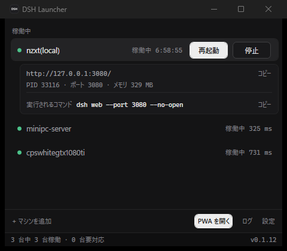
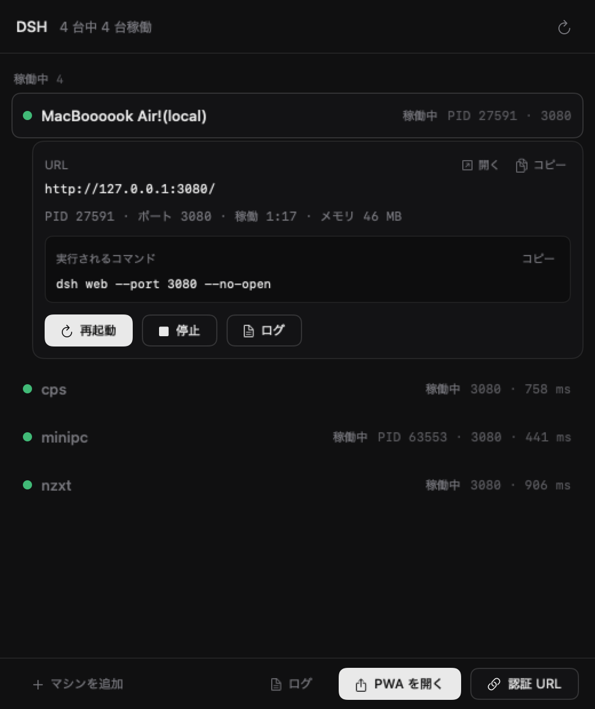

# DSH Launcher

DeepSeek Harness（dsh）を、このPCとリモートマシンで起動・再起動・停止・状態確認するための
Windows デスクトップアプリ（WPF / .NET 9）＋ CLI（`dshl`）。同じ exe が GUI と CLI を兼ねる。

macOS 版（SwiftUI メニューバーアプリ＋CLI）も同じリポジトリの [mac/](mac/README.md) にあります。

> 非公式のサードパーティ製ランチャーです。DeepSeek 公式の製品ではなく、DeepSeek による承認・提携・サポートはありません。
> 「DeepSeek Harness」は DeepSeek の登録商標で、本プロジェクトでは互換性の説明にのみ使用しています。
> 詳細は [ライセンスと非公式について](#ライセンスと非公式について)。



## インストール

Windows 10/11（x64）。Releases の exe は単体で動く（.NET ランタイム不要、自己完結版）。

### かんたんインストール（推奨）

```powershell
irm https://github.com/Aosy0/dsh-launcher/releases/latest/download/install.ps1 | iex
```

- `%LOCALAPPDATA%\Programs\DshLauncher\dshl.exe` に配置し、スタートメニューに「DSH Launcher」を追加する
- 配布物の SHA256 を `SHA256SUMS.txt` と照合してから配置する
- 更新: 同じコマンドを再実行、または `& "$env:LOCALAPPDATA\Programs\DshLauncher\update.cmd"`
- アンインストール（設定・ログも消すなら `-Purge`）:
  ```powershell
  & "$env:LOCALAPPDATA\Programs\DshLauncher\uninstall.cmd"
  ```

### ポータブル（インストールしない）

[Releases](https://github.com/Aosy0/dsh-launcher/releases) から `dshl-<version>-win-x64.exe` をダウンロードして
実行するだけ（約 70MB、.NET 不要）。
.NET 9 Desktop Runtime が入っている場合は軽量版 `dshl-<version>-win-x64-framework-dependent.exe`（約 0.5MB）も使える。

未署名の exe のため、初回は SmartScreen の「Windows によって PC が保護されました」が出ることがある。
「詳細情報」→「実行」で進む。

### 前提

| 使う機能 | 必要なもの |
|---|---|
| このPCの DSH を起動 / 停止 | Node.js 24.9 以上と dsh（`npm i -g @deepseek-ai/dsh`） |
| リモートの DSH を操作 | `~/.ssh/config` のホストエイリアス（鍵認証） |
| PWA を開く | PWA に対応した Chromium 系ブラウザ（Chrome / Edge / Brave など）と、DSH をそのブラウザで「アプリとしてインストール」したもの |

## はじめかた

1. 起動するとマシン一覧のウィンドウとトレイ常駐が始まる。初回に `%APPDATA%\DshLauncher\hosts.json` を作成し、
   `~/.ssh/config` のホストを一覧へ自動で追加する（プロファイル名・ポート・URL は「設定」で編集）。
2. このPCの行の「起動」で DSH を起動する（タスクスケジューラ経由なので、ランチャーを閉じても残る）。
3. リモートが「要セットアップ」なら「DSH をセットアップ」で Node と dsh を導入する。
4. ボトムバー / トレイの「PWA を開く」で、DSH をインストール済みブラウザの Web アプリ（PWA）として開ける。
   初回（未認証）は自動で認証を更新してから開く。未インストールなら、ブラウザで開いて追加する手順を案内する。
5. コマンドラインは同じ exe:

   ```powershell
   & "$env:LOCALAPPDATA\Programs\DshLauncher\dshl.exe" status --json
   ```

## macOS 版（v0.1.0 / 2026-11-13）

macOS 向けに、メニューバー常駐の SwiftUI アプリと CLI（`dshl`）を `mac/` に実装しました。
Windows 版（WPF）とはコードを共有せず、launchd・`open`・`~/Applications` の Web アプリなど
macOS の作法で作り直しています。

- ビルド: `cd mac && ./build.sh`（Xcode Command Line Tools が必要）
- インストール: `./install.sh`（`~/Applications/DSH Launcher.app` と `~/.local/bin/dshl`。sudo 不要）
- ローカル起動は LaunchAgent（`RunAtLoad` 無効 + `kickstart`）。ランチャーを閉じても dsh は残る
- リモートは Windows 版と同じ SSH + ヘルパー方式（`agent.sh` / `agent.ps1`）
- PWA は `~/Applications/*.localized` の `.app` を検出して `open -a`。認証 URL も発行可能
- 未署名（ad-hoc）・自動更新なし・PWA の初回認証自動化は未対応



使い方・制限・開発手順は [mac/README.md](mac/README.md)、設計は [DESIGN.md](DESIGN.md) の
「13. macOS 版」を参照してください。

## ドキュメント

| 内容 | 場所 |
|---|---|
| セッション引き継ぎ（最小） | [AGENTS.md](AGENTS.md) |
| 設計・デザイン・決定事項 | [DESIGN.md](DESIGN.md) |
| 開発・構成・障害対応 | [docs/DEVELOPMENT.md](docs/DEVELOPMENT.md) |

## 実装状況（v0.1.16 / 2026-11-13）

| 機能 | 状態 |
|---|---|
| 一覧ウィンドウ（状態グループ・選択行の展開・集計） | ✅ 実装 |
| ローカル: 起動 / 再起動 / 停止 / 状態（PID・稼働時間・メモリ） | ✅ 実装・実機確認 |
| ローカルの表示名 `マシン名(local)` | ✅ `nzxt(local)` |
| マシン名の編集（右クリック → 名前を変更…、`dshl rename`） | ✅ 実装 |
| トレイ常駐（集計・マシン別サブメニュー・一括再起動・終了） | ✅ 実装 |
| 確認ダイアログ（対象・実行コマンド・現在状態） | ✅ 実装 |
| リモート: SSH 検出（OS / Node / dsh / ~/.dsh / ポート / 遅延） | ✅ 実機確認 |
| リモート: ヘルパー自動配置（`setup`） | ✅ 実機確認（minipc-server へ配置） |
| リモート: 起動 / 再起動 / 停止 | ✅ 実機確認（minipc-server を起動し HTTP 401 まで確認） |
| リモート: DSH の自動セットアップ（Node 24.9+ と dsh） | ✅ 実機確認（minipc-server: Node v24.13.0 / dsh 0.2.2-rc.1） |
| ログ表示（ローカルはファイル、リモートは tail） | ✅ 実装 |
| マシン追加（SSH エイリアス・ポート・プロファイル） | ✅ 実装 |
| PWA を開く（ブラウザの Web アプリ、マシン非依存） | ✅ 実装・実機確認（Chrome / Edge / Brave の Web アプリ検出、初回認証の自動化） |
| 新しいブラウザの認証 URL（`?token=` 付き）の発行 | ✅ 実装・実機確認（v0.1.16。ボトムバー / 行メニュー / トレイ / CLI） |
| アプリ内更新（通知 → ダウンロード → 置き換え → 再起動） | ✅ 実装・実機確認（v0.1.15） |
| 配布（GitHub Releases / install.ps1 / アイコン） | ✅ v0.1.10 から |
| URL の編集 UI / フィルタ表示（9台以上） | ⏳ 次段 |

## 修正履歴（v0.1.16）

- **新しいブラウザの認証 URL を発行**。dsh web が起動時に 1 回だけ出力する `?token=` 付き URL を、
  ボトムバー「認証 URL」・ローカル行メニュー・トレイ・`dshl auth-url` から発行できるようにした。
  - 取得元はランチャーが起動した dsh のログ（`%APPDATA%\DshLauncher\logs\<id>.log`）。
    `dsh web: …?token=…` を新しい順に拾い、稼働中のサーバーが **3xx + `Set-Cookie: dsh-auth-…` を返す
    ものだけ**を採用する（再起動前の古いトークンは 401 で捨てる。検証クライアントは Cookie を保持しない）
  - ダイアログに公開 URL（Tailscale など）と「この PC のブラウザ用」（`127.0.0.1`）を並べ、
    コピーと「ブラウザで開く」を用意。PID と注意書きも表示する
  - CLI: `dshl auth-url [machine] [--copy] [--open] [--json]`（stdout は URL 1 行）
  - PWA 自動認証の説明にあった「起動ログは排他ロックで読めない」を実測に合わせて訂正
  - `docs/DEVELOPMENT.md` の制御文字（BEL）を修正

## 修正履歴（v0.1.15）

- **アプリ内更新を追加**。起動後と6時間ごとに GitHub Releases を確認し、新しければ
  ステータスバーに「v0.1.15 に更新」、トレイに通知（バルーン）を出す。クリックすると
  **ブラウザを開かずに**ダウンロード → SHA-256 検証 → 置き換え → 新しいバージョンで再起動まで行う。
  - ダウンロードするのは実行中の exe と同じ種類（自己完結 / framework-dependent。exe サイズで判定）
  - 置き換えは非表示の PowerShell ヘルパーが「本体の終了待ち → exe 差し替え → 起動」を行う
  - 更新先に書き込めない場合・別のランチャーが起動中の場合は実行せず理由を表示
  - トレイメニューに「更新を確認…」「v0.1.15 に更新…」、CLI に `dshl update [--check] [--dry-run] [--json]`

## 修正履歴（v0.1.14）

- **PWA の初回認証を自動化**。「PWA を開く」で未認証（401 画面）を検知すると、
  DSH が発行するブラウザセッションクッキーを自動で発行してブラウザプロファイルに設定し、PWA を開き直す。
  - dsh web は署名つき HttpOnly クッキー（`dsh-auth-*`）で UI を保護する。通常は起動時に表示される
    `?token=` 付き URL を開いて取得するが、PWA の自動認証では**その URL を開き直さない**。
    `$DSH_HOME/.credentials.yaml` の browser-session secret から**同じクッキーを再生成**し、
    ランチャーの一時ローカルページ（`http://127.0.0.1:<ephemeral>/`、クッキーはポート非依存）経由で
    ブラウザに設定する。設定先は**非表示のアプリウィンドウ**なので、タブやウィンドウは残らず、
    ワンタイムの URL も履歴に残らない。
  - 認証済みかどうかは、PWA のウィンドウタイトル（401 は `127.0.0.1:3080`、認証済みはアプリ名）と
    `%APPDATA%\DshLauncher\pwa-auth.json`（ブラウザ・プロファイル・有効期限）で判断する。
  - 自動認証は `http://127.0.0.1:<port>` からインストールした PWA が対象（クッキーを設定できるループバック限定）。
    `dshl pwa --open` でも同じ自動認証が働く。

- 「Brave」前提だった表記を**「ブラウザ」に統一**し、PWA（Web アプリ）を
  **Chrome / Edge / Brave / Chromium** から自動検出して起動できるようにした。
  - 検出は各ブラウザの `<User Data>\<Profile>\Web Applications\_crx_<id>`（Edge は `_crx__<id>`）。
    起動はブラウザ同梱の `chrome_proxy.exe` / `msedge_proxy.exe` に `--profile-directory` と `--app-id` を渡す。
  - Firefox など Web アプリをインストールできないブラウザは対象外（UI 上は特定ブラウザ名を出さない）。
  - 未インストール時の案内: 「ブラウザで開く」で既定のブラウザに URL を開く。
- ボトムバーの「PWA を開く」ボタンの**内側の余白が狭い**問題を修正。ボタンのテンプレートが `Padding` を
  使っておらず、幅の広いラベル（PWA を開く / セットアップ / ブラウザで開く）で文字が端に寄っていた。
  テンプレートに左右 14px の余白を追加し、高さも他の主ボタンと同じ 28px に揃えた。
- CLI: `dshl pwa --json` に `browser`（起動に使うブラウザ）と `browsers`（検出したブラウザ一覧）を追加。

## 修正履歴（v0.1.12）

- アプリアイコンを `>_` のプロンプト記号から **DSH の文字マーク**へ変更（ターミナルエミュレーターに見えるため）。
  各サイズは `design/icon-sizes.png`。
- インストール先に `update.cmd` / `uninstall.cmd` を追加。Windows の既定の実行ポリシー（Restricted）でも
  更新・アンインストールができる（`powershell -ExecutionPolicy Bypass` 経由の .cmd）。
  配置先の `install.ps1` は Windows PowerShell 5.1 でも読めるよう **UTF-8 BOM 付き**で書き出す。
  アンインストールは、実行中の .cmd が消えて cmd.exe がエラーを出さないよう**終了後にバックグラウンドで削除**する。

## 修正履歴（v0.1.11）

- `install.ps1` の修正: 配置先にコピーされたインストーラから `-Uninstall` を実行したとき、
  `-InstallDir` を指定してインストールしていても**元の配置先**（dshl.exe と同じフォルダ）を既定にする。
  インストール先の削除はロックが外れるまで数回リトライする。

## 修正履歴（v0.1.10）

- **他のPCへ配布できるようにした**。
  - 自己完結の単一 exe（.NET ランタイム不要、約 70MB）と framework-dependent（約 0.5MB、.NET 9 Desktop Runtime が必要）を
    GitHub Releases に添付。`.github/workflows/release.yml` が `v*` タグの push でビルドして Release を作成する
    （タグと csproj の `<Version>` が一致しないと失敗）。
  - `install.ps1`: latest の exe を取得 → `SHA256SUMS.txt` と照合 → `%LOCALAPPDATA%\Programs\DshLauncher` に配置 →
    スタートメニューにショートカット。`-Uninstall` / `-Purge`。自分自身も配置先にコピーするので更新・削除に再取得は不要。
  - アプリアイコン（`src/DshLauncher/app.ico`、`python tools/make-icon.py` で生成）を追加し、
    ウィンドウ・トレイ・ショートカットを同じ意匠に。exe のメタデータ（ProductName / Description）も設定。

## 修正履歴（v0.1.9）

- PWA を開く導線を**マシンから独立**させ、ボトムバー右の主ボタンと**トレイの最上位**に置いた。名前は「**PWA を開く**」。
  行メニュー・選択行の展開・トレイのマシン別サブメニューからは外した（PWA はこのPCの DSH に属するもので、マシン行の操作ではないため）。
- CLI: `dshl pwa [--open] [--dry-run] [--json]` に整理（情報表示 / 起動 / 実行コマンド表示 / JSON）。
  v0.1.8 の `dshl open <machine> --app` と `dshl apps` は削除。
- 検出と起動の仕組みは v0.1.8 のまま（`chrome_proxy.exe --profile-directory="Profile N" --app-id=<id>`）。

## 修正履歴（v0.1.8）

- ローカル DSH の PWA（ブラウザの Web アプリ）検出と起動を追加
  （v0.1.9 で導線をマシン非依存に、v0.1.13 で Chromium 系ブラウザ一般に拡張）。
  - Brave の Web アプリは `chrome_proxy.exe --profile-directory="Profile N" --app-id=<id>` で起動する
    （Start Menu の `Brave Apps` ショートカットと同じ行）。
  - app id は **Web App Manifest の id を二重 SHA-256** した Chromium の a–p 記法。DSH は manifest に `id` が無く
    `start_url: "./"` なので、manifest id は URL のディレクトリ（既定はオリジン直下）。
    実測: `http://127.0.0.1:3080/` → `hgiemfgfjhalibdoboikeiepnnjapnpc`（存在の判定は
    `Web Applications\_crx_<id>` と `Manifest Resources\<id>`）。
  - PWA が未インストールなら案内ダイアログを出し、「Brave で開く」で URL をタブで開く。
  - SSH マシンは `url` 未設定だと `http://127.0.0.1:<port>/` に解決され、この PC の PWA と一致してしまうため対象外。
  - 起動は既存のブラウザ起動と同じく子プロセスを残さない（`UseShellExecute`。DSH 本体の起動だけがタスクスケジューラ経由）。

## 修正履歴（v0.1.7）

- 起動/再起動中のインジケータバーが「左から出て途中で消える」問題を修正。
  600ms ごとの一覧再描画でバーを作り直していたのが原因。操作中は**経過秒数のテキストだけ更新**し、
  バーのアニメーションを維持するようにした（再描画は操作完了時のみ）。リモート起動でも同様。

## 修正履歴（v0.1.6）

- 右下のバージョン表記を固定文字列 0.1 から**アセンブリのバージョン**（csproj の <Version>）表示に変更。
- CLI に dshl --version（および dshl version）を追加。現在は **v0.1.6**。
- 今後バージョンを上げるときは src/DshLauncher/DshLauncher.csproj の <Version> を更新して再ビルド。

## 修正履歴（v0.1.5）

- Windows リモートのセットアップ失敗を修正:
  - `.ps1` を **UTF-8 BOM 付き**で配置（BOM なしだと Windows PowerShell 5.1 が CP932 として読み、日本語入りスクリプトが構文エラーになる）。
  - Windows 側ヘルパーのパラメータ `$Profile` が PowerShell の**自動変数**と衝突していたため `$ProfileName` に改名。
  - `Get-Command dsh` が `.ps1` シムを返し `cmd.exe` から実行できなかったため、`%APPDATA%\\npm\\dsh.cmd` を優先。
  - SSH セッション終了で子プロセスが落ちるため、Windows リモートも **タスクスケジューラ + wscript 非表示起動**に統一。
- 例外メッセージを**コピー可能**に: ダイアログに「コピー」ボタン、本文・受領書は選択可能、ログ窓に「すべてコピー」。
- 実測: cpswhitegtx1080ti で Node v26.13.0 / dsh 0.2.2-rc.1 を導入 → 起動（HTTP 401）→ 停止（タスク・ポート掃除）まで確認。

## 修正履歴（v0.1.4）

- リモートマシンへの **DSH セットアップ** を追加。`dshl setup <machine> --install`、GUI は「要セットアップ」行のボタン／右クリック →「DSH をセットアップ…」。
  - Linux: nvm があれば `nvm install 24`、無ければポータブル Node 24 を `~/.dsh/runtime/node` に導入 → `npm i -g @deepseek-ai/dsh@latest` → ヘルパー配置。
  - Windows: Node 24.9+ を確認 → `npm i -g @deepseek-ai/dsh@latest` → ヘルパー配置。
  - 実行結果は画面のログ窓と `%APPDATA%\DshLauncher\logs\<id>-setup.log` に残る。
- リモートのヘルパーが nvm / ポータブル Node の PATH を自分で解決するように修正（非対話 SSH で dsh が見つからない問題）。
- リモート起動コマンドの誤り（`web --profile` 二重指定）を修正。

## 修正履歴（v0.1.3）

- 行内の「再起動 / 停止 / 起動」ボタンの余白を拡大（高さ28px・左右パディング14px・最小幅64px・ボタン間8px・行パディング10px・行高38px）。

## 修正履歴（v0.1.2）

- 起動/再起動/停止中に**進行表示**を追加: 行内に「起動中 12s」などの経過秒数とインジケータバー（WPFアニメーション）、下部ステータスバーに「更新中…」表示とバー。
- 起動用のターミナル窓が残る問題を修正: Task Scheduler のアクションを wscript.exe 経由の**非表示ランチャー**（run-<id>.vbs）に変更。
  停止時にタスクと残った cmd ラッパーを掃除するので、旧バージョンが開いた窓も停止/再起動で消えます。

## 修正履歴（v0.1.1）

- ダイアログのボタンが反応しない問題を修正（ウィンドウ全体の DragMove() がマウスを掴み、Border 疑似ボタンのクリックを飲んでいた）。ボタンを本物の Button（ControlTemplate 付き・UIAutomation 対応）に変更し、ドラッグは非インタラクティブ領域のみに限定。
- キャンセルでダイアログが閉じない問題も同根で解消。実機で「キャンセル→PID不変」「再起動→PID変更」を確認。
- 受領書のコマンド表記を dsh <profile> --port <port> --no-open に短縮。

## 起動（リポジトリのビルド）

```powershell
# GUI（トレイ常駐）
C:\Users\koboy\Documents\dsh-launcher\dist\dshl.exe

# CLI（同じ exe）
dshl status [machine] --json
dshl start|stop|restart [machine] [--dry-run] [--json]
dshl machines / url / logs / setup / rename / add / remove
dshl open [machine] [--dry-run]
dshl pwa [--open] [--dry-run] [--json]
dshl auth-url [machine] [--copy] [--open] [--json]
dshl update [--check] [--dry-run] [--json]
dshl gui
```

- **更新**: 新しいバージョンがあるとボトムバー上（ステータスバー）とトレイで通知する。
  クリックでダウンロード・検証・差し替え・再起動まで自動（ブラウザは開かない）。
  `dshl update --check` で確認だけ、`dshl update` で適用。

- **PWA を開く**: ボトムバー右の「PWA を開く」、または `dshl pwa --open`。
  ブラウザの Web アプリ（このPCの DSH）を独立ウィンドウで開く。未インストールならインストール手順を案内する。
  **未認証（401）なら自動で認証クッキーを発行してから開き直す**（`~/.dsh/.credentials.yaml` の
  browser-session secret から生成。対象は `http://127.0.0.1:<port>` の PWA）。認証状態は
  `%APPDATA%\DshLauncher\pwa-auth.json` に保存する。
  `dshl pwa --json` で、起動に使うブラウザ（`browser`）・検出したブラウザ一覧（`browsers`）・
  認証状態（`authenticated`）・自動認証の可否（`authAvailable`）を確認できる。

- **認証 URL**: ボトムバーの「認証 URL」、ローカル行の右クリック →「認証 URL を発行…」、
  トレイの「認証 URL を発行…」、または `dshl auth-url`。**新しいブラウザ**（別プロファイル・別端末）を
  DSH に認証する `?token=` 付き URL を発行する。
  - 取得元はランチャーが起動した dsh のログ（`%APPDATA%\DshLauncher\logs\<id>.log`）。
    起動時に dsh web が 1 回だけ出力する `dsh web: …?token=…` を新しい順に拾い、
    **稼働中のサーバーが 3xx（`Set-Cookie: dsh-auth-…` 付き）を返すものだけ**を採用する
    （再起動前の古い行は 401 で捨てる）。検証クライアントは Cookie を保持しない。
  - 表示する URL は、`hosts.json` の `url`（設定されていれば）、無ければログの URL が公開アドレスならそれ、
    それも無ければ `http://127.0.0.1:<port>/`。トークンは authority に依存しないので、同じ DSH なら
    ループバックでも公開 URL（Tailscale など）でも使える。ダイアログは両方を「コピー」「ブラウザで開く」付きで出す。
  - URL は認証情報。ランチャー自身はトークンをファイルに保存しない（表示・コピー・CLI の stdout/JSON のみ）。
    DSH を再起動すると URL は変わる。
  - 対象はランチャー経由で起動したローカル DSH（リモートは未対応）。

- 設定: `%APPDATA%\DshLauncher\hosts.json`（秘密情報なし。SSH は `~/.ssh/config` のエイリアスを使用）
- ローカル起動は **タスクスケジューラ経由**（`DshLauncher\start-<id>`）。サーバーがランチャーの
  プロセスツリーから外れるため、CLI をパイプで使っても待たされず、ランチャーを閉じても残る。
- ローカル起動時のログ: `%APPDATA%\DshLauncher\logs\<id>.log`
- リモートのヘルパー: `~/.dsh/dshl/agent.sh`（POSIX）/ `agent.ps1`（Windows）。`dshl setup <machine>` で配置。
- 終了コード: `0` ok / `1` error / `2` no change / `3` unreachable / `4` needs setup

## 構成

```
dsh-launcher/
├─ .github/workflows/release.yml  # v* タグ → ビルドして GitHub Release を作成
├─ install.ps1            # 配布用インストーラ（latest を取得・検証・配置）
├─ tools/make-icon.py     # app.ico の生成（Pillow が必要）
├─ DESIGN.md              # 監査・方向・9パス・リモート設計・CLI仕様・決定事項
├─ design/
│  ├─ v1/ v2/ v3/         # デザインの変遷（v3 が確定、15-gui-window.png は実機）
├─ mockups/v0/            # 最初の3案（比較用）
├─ src/DshLauncher/       # WPF (.NET 9) 実装
│  ├─ app.ico             # アプリアイコン（tools/make-icon.py で生成）
│  ├─ Program.cs          # GUI/CLI 分岐（WinExe + コンソール接続）
│  ├─ Model.cs            # 設定・状態・ポート検出
│  ├─ Local.cs            # ローカル起動/停止/状態（タスクスケジューラ起動）
│  ├─ Remote.cs           # SSH・リモート検出/操作・ヘルパースクリプト
│  ├─ BrowserApp.cs        # ブラウザの Web アプリ（PWA）の検出と起動（app id 算出・プロファイル走査）
│  ├─ PwaAuth.cs           # PWA の初回認証（署名クッキーの発行・ブラウザへの設定・認証状態）
│  ├─ AuthUrl.cs           # 新しいブラウザの認証 URL（起動ログの ?token= を検証して発行）
│  ├─ Update.cs            # アプリ内更新（GitHub Releases 確認・検証・差し替え・再起動）
│  ├─ Cli.cs              # dshl サブコマンド
│  ├─ Ui.cs               # 一覧ウィンドウ・トレイ・テーマ
│  └─ Dialogs.cs          # 確認・名前変更・マシン追加・ログ
├─ mac/                   # macOS 版（SwiftUI + AppKit + CLI）
│  ├─ build.sh            # .app / dshl / zip を生成
│  ├─ install.sh          # ~/Applications と ~/.local/bin に配置
│  └─ Sources/DshLauncherMac/  # launchd・SSH・認証URL・PWA・UI
└─ dist/dshl.exe          # ビルド済み単一ファイル（.NET 9 Desktop Runtime 使用）
```

リリースの作り方・配布物のビルドは [docs/DEVELOPMENT.md](docs/DEVELOPMENT.md) を参照。

## ライセンスと非公式について

- **ライセンス**: [MIT](LICENSE)（Copyright (c) 2026 Aosy）。商用利用・改変・再配布可、無保証。
- **非公式**: 本プロジェクトはサードパーティ製で、DeepSeek 公式ではありません。DeepSeek による承認・提携・サポートはありません。
- **名称**: 上流の [ブランドガイドライン](https://github.com/deepseek-ai/deepseek-harness/blob/master/BRAND_GUIDELINES.md) に従い、
  プロジェクト名には略称 **DSH** を使用し、フルネーム「DeepSeek Harness」は互換性の説明にのみ使用します。
  「DeepSeek Harness」は DeepSeek の登録商標です。公式ロゴ・ブランド素材は使用していません（アイコンは本プロジェクトの自作）。
- **上流**: DeepSeek Harness（`dsh`）は [MIT](https://github.com/deepseek-ai/deepseek-harness/blob/master/LICENSE) で公開されています。
  本ランチャーは `dsh` のコードを同梱・改変せず、CLI の起動と Web UI / PWA を開くだけです。
- **開発者プレビュー**: DSH は developer preview で互換性が壊れる変更があります。本ランチャーの追従・動作は保証しません。

## 実測メモ

| ホスト | OS | Node | dsh | 状態 |
|---|---|---|---|---|
| このPC（nzxt(local)） | Windows | v24.18.0 | 0.2.2-rc.1 | 稼働中 |
| minipc-server | Linux | v24.13.0 | 0.2.2-rc.1 | 停止（セットアップ・起動/停止まで実機確認） |
| cpswhitegtx1080ti | Windows | v26.13.0 | 0.2.2-rc.1 | 停止（セットアップ・起動/停止まで実機確認） |
| macbook（MacBoooook Air!） | macOS 27.0.1 | v24.16.0 | 0.2.2-rc.1 | 稼働中（macOS 版・launchd 管理で実機確認） |


