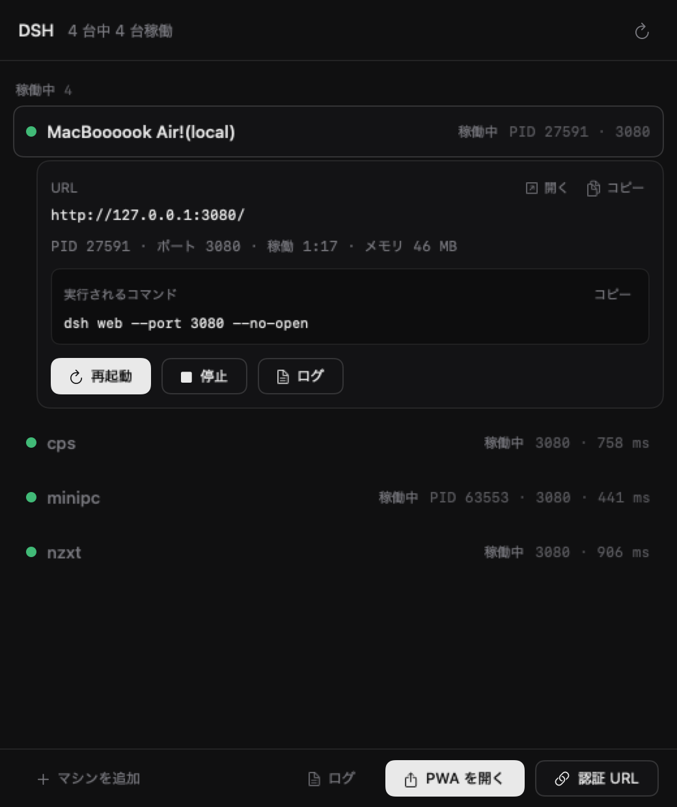

# DSH Launcher for macOS

DeepSeek Harness（`dsh`）を Mac 上で起動・再起動・停止・状態確認するための非公式ランチャーです。
メニューバー常駐の SwiftUI アプリと、同じバイナリで動く CLI（`dshl`）で構成します。

> 非公式のサードパーティ製ツールです。DeepSeek 公式の製品ではなく、DeepSeek による承認・提携・
> サポートはありません。「DeepSeek Harness」は DeepSeek の登録商標で、本プロジェクトでは互換性の
> 説明にのみ使用しています。ライセンスは [MIT](../LICENSE)（無保証）。

Windows 版（WPF）とは実装を共有せず、macOS の作法（launchd、`open`、`/usr/sbin/lsof`、
`~/Applications` の Web アプリ）で作り直しています。設計判断は
[DESIGN.md](../DESIGN.md) の「13. macOS 版」を参照してください。



## 動作環境

| 用途 | 必要なもの |
|---|---|
| ビルド | macOS 13 以降、Xcode Command Line Tools（`swift` / `sips` / `iconutil` / `codesign`） |
| この Mac の DSH を起動・停止 | Node.js 24.9 以上と `dsh`（`npm i -g @deepseek-ai/dsh`） |
| リモートの DSH を操作 | `~/.ssh/config` のホストエイリアス（鍵認証、BatchMode 可） |
| PWA を開く（任意） | Chrome / Brave / Vivaldi / Edge のいずれかで DSH を「アプリとしてインストール」したもの |

確認環境: Apple M1 / macOS 27.0.1 / Xcode 27.2 / Swift 6.4。macOS 13 以降を対象にビルドします。

## ビルド

```sh
cd mac
./build.sh
```

`dist/` に次を出力します。

- `dist/DSH Launcher.app` — アプリ本体（ad-hoc 署名）
- `dist/dshl` — CLI ラッパー
- `dist/DSHLauncher-mac-<arch>.zip` — 配布用 zip

バージョンを変えるときは `VERSION=0.1.1 ./build.sh`（既定 0.1.0）。

## インストール

```sh
cd mac
./build.sh
./install.sh
```

- アプリを `~/Applications/DSH Launcher.app` に配置します（`/Applications` や sudo は不要）
- CLI を `~/.local/bin/dshl` に置きます。`~/.local/bin` が PATH に無い場合は `~/.zshrc` に追加:
  ```sh
  export PATH="$HOME/.local/bin:$PATH"
  ```
- アンインストール: `./uninstall.sh`（設定・ログも消すなら `--purge`）

未署名（ad-hoc 署名のみ）なので、ダウンロードした zip を展開した場合は Gatekeeper の警告が
出ることがあります。Finder で右クリック →「開く」、または:

```sh
xattr -dr com.apple.quarantine "$HOME/Applications/DSH Launcher.app"
```

開発中は `open "dist/DSH Launcher.app"` で直接起動しても構いません。

## 使い方

1. 起動すると一覧ウィンドウとメニューバー項目が現れます。ウィンドウを閉じてもメニューバーに残ります
   （終了はメニューバーの「DSH Launcher を終了」または ⌘Q）。
   ログイン時に自動起動するには、システム設定 → 一般 → ログイン項目 に
   `DSH Launcher.app` を追加します（任意）。
2. 初回起動時に `hosts.json` を作り、`~/.ssh/config` の `Host` をリモート候補として追加します。
3. 行を選ぶと詳細（URL、PID、稼働時間、メモリ、実行コマンド）が開きます。
   「起動 / 再起動 / 停止」は、実行前に**実行するコマンドを見せる確認ダイアログ**を出します。
4. メニューバーからは、集計、マシン別の操作、PWA、認証 URL、一覧の再表示ができます。
5. 「+ マシンを追加」で SSH エイリアス・ポート・プロファイルを登録できます。

### CLI

```sh
dshl status [machine] [--json]
dshl start|stop|restart [machine] [--yes] [--dry-run] [--json]
dshl machines [--json]
dshl url [machine]
dshl logs [machine] [-n 50]
dshl setup [machine] [--install] [--dry-run]   # ヘルパー配置 / Node と dsh の導入
dshl rename <machine> <name>
dshl add <name> <ssh-alias> [linux|windows|macos]
dshl remove <machine>
dshl open [machine] [--dry-run]
dshl pwa [--open] [--dry-run] [--json]
dshl auth-url [machine] [--copy] [--open] [--json]
dshl gui [--config <path>]
dshl --version
```

終了コードは Windows 版と同じです: `0` 成功 / `1` エラー / `2` 変更なし / `3` 到達不可 /
`4` 要セットアップ。`--config` で別の `hosts.json` を使えます（ラボ検証用）。

## ローカル DSH の起動方式（launchd）

Windows 版の「タスクスケジューラ + wscript」に相当する仕組みとして、macOS では
**ユーザー LaunchAgent** を使います。

- 起動時に `~/Library/LaunchAgents/io.github.aosy0.dshlauncher.start-<id>.plist` を生成し、
  `launchctl bootstrap gui/<uid>` → `launchctl kickstart -k` で起動します。
- `RunAtLoad` は無効です。ログイン時に勝手に起動せず、`dshl start`（または UI の起動）だけが
  明示的に開始します。`KeepAlive` も無効なので、dsh が終了しても自動再起動はしません。
- ランチャーを終了しても dsh は残ります。停止は `launchctl bootout` のあと、ポートを占有している
  プロセスツリー（子プロセス含む）を終了し、plist を削除します。
- 起動スクリプトは `~/Library/Application Support/DshLauncher/run/<id>.sh` に生成します。
  GUI アプリはシェルの PATH を継承しないため、`~/.nvm` / `~/.npm-global/bin` /
  `/opt/homebrew/bin` から Node 24.9+ と `dsh` を解決し、PATH を明示してから起動します。
- ログ: `~/Library/Application Support/DshLauncher/logs/<id>.log`
  （`dsh web:` の `?token=` URL もここに残ります）
- アプリ自身のログ: `~/Library/Application Support/DshLauncher/logs/app.log`
- ログには認証用の `?token=` が平文で残るため、`logs` とアプリのデータフォルダは
  パーミッション 0700、ログファイルは 0600 にしています（LaunchAgent の `Umask` も 077）。
  ログを共有するときは token を伏せてください。

### データの場所

| 種類 | 場所 |
|---|---|
| 設定 | `~/Library/Application Support/DshLauncher/hosts.json` |
| 起動ログ・アプリログ | `~/Library/Application Support/DshLauncher/logs/` |
| 起動スクリプト | `~/Library/Application Support/DshLauncher/run/` |
| LaunchAgent | `~/Library/LaunchAgents/io.github.aosy0.dshlauncher.start-<id>.plist` |
| リモートヘルパー | `~/.dsh/dshl/agent.sh`（POSIX）/ `agent.ps1`（Windows） |
| PWA 認証 secret | `~/.dsh/.credentials.yaml`（DSH が管理。ランチャーは読み書きしない） |

## リモート

`~/.ssh/config` の `Host` エイリアスをそのまま使います。認証は鍵 / ssh-agent のみで、
パスワードは保存しません（`BatchMode=yes`、`ConnectTimeout=5`）。

- 状態検出は SSH 1 回で、`uname -s` / `node -v` / `command -v dsh` / `~/.dsh` /
  ポートの LISTEN / ヘルパーの `status` をまとめて取得します。PATH は非対話 SSH 向けに
  `~/.dsh/npm-global/bin`、`~/.dsh/runtime/node/bin`、`~/.local/bin`、`~/.npm-global/bin`、
  nvm の各バージョンを前置します。
- Linux / macOS は POSIX ヘルパー、Windows リモートは PowerShell ヘルパーで操作します。
- ヘルパーの配置は `dshl setup <machine>`（`--install` を付けると Node 24.9+ と dsh も導入）。
  自動では配置しません。
- macOS のリモートでは `setsid` が無いため、`nohup` で起動し、停止は pidfile と
  `lsof` / `pgrep` で子プロセスも終了します。

## 認証 URL

dsh web は起動時に一度だけ `dsh web: <url>?token=...` を出力します。ランチャーはこの起動ログ
（末尾 256 KB）から候補を拾い、**稼働中のサーバーが 3xx + `Set-Cookie: dsh-auth-…` を返す
ものだけ**を採用します。古いトークンは 401 で捨てます（検証クライアントは Cookie を保持しない）。

- 対象は**ランチャー経由で起動したローカル DSH** のみです。リモートは未対応です。
- トークンは認証情報そのものです。ランチャーはファイルに保存せず、画面・クリップボード・
  CLI の stdout / JSON に出すだけです。dsh を再起動すると URL は変わります。
- 起動直後はトークン行が揃うまで最大 10 秒待ってから判定します。

## PWA（Web アプリ）を開く

Chromium 系ブラウザで「アプリとしてインストール」した Web アプリは、macOS では
`~/Applications/Chrome Apps.localized` などの `.app` バンドルとして保存されます。
ランチャーは各バンドルの `Contents/Info.plist` の `CrAppModeShortcutID` /
`CrAppModeShortcutURL` を読み、URL または app id（manifest id の二重 SHA-256）で一致するものを
`open -a` で起動します。インストールは行いません。未インストールなら既定ブラウザで URL を
開き、インストール手順を案内します。

**制限**: 初回認証（401）のクッキーを自動生成する処理は未実装です。初回は「認証 URL」を
発行してブラウザで開くか、`dshl auth-url --open` を使ってください。

### 開発用: UI を画像に出す

SSH からは macOS の TCC 制限で `screencapture` が使えないため、次のコマンドで
一覧ウィンドウをオフスクリーン描画して PNG にできます（開発用。ユーザー向け機能ではありません）。

```sh
~/.local/bin/dshl snapshot /tmp/dshl-ui.png
```

`design/mac-v1.png` はこの方法で撮ったものです。

## 制限・既知の未対応

- 未署名（ad-hoc）。公証（notarization）はしていません。
- アプリ内自動更新は未対応です（ビルドし直してください）。
- 認証 URL はローカルのみ。リモート DSH の認証 URL は発行できません。
- PWA の自動認証（Cookie の再生成・設定）は未実装です。
- 配布 zip はビルドしたアーキテクチャ向けです（確認は arm64）。Intel Mac はソースからビルドしてください。
- UI は日本語のみ、ダークテーマ固定です。
- SSH からのスクリーンショット取得は macOS の TCC 制限で失敗するため、UI の自動検証は
  プロセス・ログ・HTTP 応答で行っています（実画面の確認は人手）。

## 開発

```
mac/
├─ Package.swift                 # SwiftPM（macOS 13+）
├─ build.sh / install.sh / uninstall.sh
├─ Support/
│  ├─ Info.plist                 # バンドル定義（__VERSION__ を置換）
│  └─ AppIcon-1024.png           # Windows 版と同じ意匠から生成
└─ Sources/DshLauncherMac/
   ├─ Entry.swift                # GUI / CLI 分岐
   ├─ App.swift                  # NSApplication、メニューバー、ウィンドウ
   ├─ AppState.swift             # ポーリング・操作・シート状態
   ├─ Model.swift                # Machine / hosts.json / 状態
   ├─ CLI.swift                  # dshl サブコマンド
   ├─ MachineOps.swift           # UI と CLI の共通入口
   ├─ LocalMachine.swift         # launchd 起動・停止・状態・ログ
   ├─ RemoteMachine.swift        # SSH 検出・操作・ヘルパー配置
   ├─ AgentScripts.swift         # agent.sh / agent.ps1
   ├─ RemoteSetup.swift          # Node + dsh のセットアップ
   ├─ DshResolver.swift          # dsh / Node 24.9+ の解決
   ├─ AuthURL.swift              # ?token= URL の発行と検証
   ├─ BrowserApp.swift           # PWA 検出・起動
   ├─ Ports.swift / Shell.swift  # ポート・プロセス・コマンド実行
   └─ UI/                        # SwiftUI（MainView / Theme / Components / Dialogs）
```

テスト方法（本番 3080 を触らないラボ）:

```sh
# 別 DSH_HOME・別ポートの設定
cat > /tmp/dshl-lab.json <<'EOF'
{"version":1,"machines":[{"id":"lab","kind":"Local","name":"lab","profile":"labweb",
 "port":3090,"pinned":true,"environment":{"DSH_HOME":"/Users/<you>/.dsh-lab"}}]}
EOF
mkdir -p ~/.dsh-lab/profiles && cp -R ~/.dsh/profiles/web ~/.dsh-lab/profiles/labweb
dshl start lab --config /tmp/dshl-lab.json --json
dshl status lab --config /tmp/dshl-lab.json
dshl auth-url --config /tmp/dshl-lab.json --json
dshl restart lab --config /tmp/dshl-lab.json
dshl stop lab --config /tmp/dshl-lab.json
```
